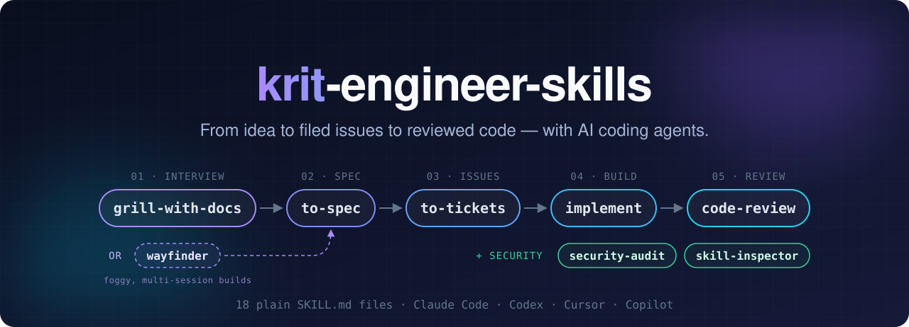

<p align="center">
  
</p>

<p align="center">
  
  
  
  
</p>

<p align="center">
  <a href="#-quickstart">Quickstart</a> ·
  <a href="#-the-core-flow">Core flow</a> ·
  <a href="#-all-skills">All skills</a> ·
  <a href="#-why-the-core-flow-exists">Why</a> ·
  <a href="#-contributing--forking">Contributing</a>
</p>

---

A standard engineering flow for shipping real products with AI coding
agents — **idea → filed GitHub issues → reviewed code** — instead of vibe
coding on feel. Built in the spirit of
[mattpocock/skills](https://github.com/mattpocock/skills) and
[utarn/engineer-skills](https://github.com/utarn/engineer-skills), adapted
and extended with real issue-tracker automation.

These are plain `SKILL.md` files: no lock-in, and they work with Claude
Code, Cursor, Codex, or Copilot. Fork it, delete what you don't need, edit
the rest.

## 🚀 Quickstart

```bash
npx skills@latest add Krit03W/krit-engineer-skills
```

> [!TIP]
> Run **`/setup-krit-skills`** first. Every other skill reads the config it writes.

| Want to… | Run |
|---|---|
| See what's inside without installing | `npx skills@latest add Krit03W/krit-engineer-skills --list` |
| Install one skill | `npx skills@latest add Krit03W/krit-engineer-skills --skill to-tickets` |
| Install for every project (user-level) | add `--global` |

## 🧭 The core flow

This is the spine. Run these in order for any real piece of work:

```
/grill-with-docs  →  /to-spec  →  /to-tickets  →  /implement  →  /code-review
```

| Skill | Invoked by | What it does |
|---|---|---|
| **`/setup-krit-skills`** | you | One-time repo config: tracker, repo, labels, doc paths. Run first. |
| **`/grill-with-docs`** | you | Interviews you about the work before any code exists, building and sharpening `CONTEXT.md` (shared vocabulary) and ADRs as it goes. |
| **`/to-spec`** | you | Turns the agreed conversation into a written spec at `docs/specs/<slug>.md`. No new questions; it writes down what was already decided. |
| **`/to-tickets`** | you | Slices the spec into vertical-slice tickets and **actually files them as GitHub/GitLab issues** (`gh issue create`), linked back to the spec. |
| **`implement`** | model | Picks up one ticket, claims it, builds it test-first (red-green-refactor), and commits with `Closes #<n>`. |
| **`/work-on-issues`** | you | Runs `implement` → `code-review` over every ready, unblocked ticket, stopping at the first blocking or ambiguous one. For burning down a backlog in one sitting. |
| **`code-review`** | model | Reviews a diff or PR against the spec's acceptance criteria *and* general code-design standards (deep modules, no dead code, real tests). |
| **`tdd`** | model | Reference: the red-green-refactor discipline `implement` runs on. |

> [!NOTE]
> Small, single-session work can skip straight from `grill-with-docs` to
> `implement`. `to-spec` and `to-tickets` earn their keep on anything that
> needs more than one sitting or more than one person.

## 🧰 All skills

Everything outside the core flow is optional. Each helper works on its own,
so skip any you never reach for and the core flow still works the same.

### 🗺️ Shaping & improving

| Skill | What it does |
|---|---|
| **`/wayfinder`** | For a greenfield project or a build spanning many sessions where the route is still foggy. Charts the effort as a map of **decision tickets** and resolves them one at a time until only implementation remains, then hands off to `to-spec` → `to-tickets`. Not for a single well-scoped feature; use `grill-with-docs` for that. |
| **`improve-codebase-architecture`** | Scans a codebase (or the part you point at) for deepening opportunities, presents them as a visual HTML report, then walks the one you pick through `grill-with-docs`. For codebases with history and friction, not new work. |

### 🤖 AI-agent helpers

If the project involves an AI agent, RAG pipeline, or MCP server,
`grill-with-docs` already pulls in agent-specific interview questions (data
boundary, tool boundary, guardrails, eval criteria). These helpers go
further for that kind of work:

| Skill | What it does |
|---|---|
| **`rag-pipeline-review`** | Audits chunking, embedding, retrieval, and reranking config against common RAG failure modes. |
| **`mcp-server-scaffold`** | Scaffolds a new MCP server with consistent tool naming, schemas, and error handling. |
| **`agent-eval-loop`** | Before/after comparison against a golden test set whenever a prompt, RAG, or graph change ships, instead of shipping on vibes. |

### 🎨 Design & research

| Skill | What it does |
|---|---|
| **`research`** | Hands a research question to a background agent that reads primary sources and writes cited findings to a Markdown file, so you can keep working. |
| **`codebase-design`** | Shared vocabulary for designing deep modules (module, interface, depth, seam, adapter, leverage, locality). Used by `improve-codebase-architecture`, and useful directly whenever a module's interface needs shaping. |
| **`prototype`** | Builds throwaway code to answer a design question: a single HTML file to sanity-check a state model, or several toggleable UI variations to answer "what should this look like?" |

### 🛡️ Security

Vendored unchanged from their upstream repos. Each folder has an
`UPSTREAM.md` with the pinned commit and how to update it.

| Skill | Source | What it does |
|---|---|---|
| **`security-audit`** | [cloudflare/security-audit-skill](https://github.com/cloudflare/security-audit-skill) · MIT | Guidance mode for security questions and focused reviews. Runs the full six-phase audit (recon → coverage-led hunting → adversarial validation → `findings.json` → independent verification → report) only when you explicitly ask to audit or pen-test a codebase. Needs Node.js for its validators and an OS-enforced sandbox before it will run target code. |
| **`skill-inspector`** | [NVIDIA/SkillSpector](https://github.com/NVIDIA/SkillSpector) · Apache 2.0 | Reviews an agent skill before you install it: a static `skillspector` scan plus a source-aware semantic review, ending in `APPROVE` / `CAUTION` / `REJECT`. Install the CLI separately (`uv tool install --python 3.13 git+https://github.com/NVIDIA/skillspector.git`); without it the skill does a manual review only. |

## 💡 Why the core flow exists

- **`grill-with-docs`** closes the #1 cause of bad AI-generated code: a
  gap between what you meant and what the agent built.
- **`to-tickets`** stops planning from staying trapped in chat. Work that
  isn't a real, assignable, trackable issue tends to get reinvented or
  forgotten by the next session.
- **`implement` + `tdd`** give the agent a feedback loop, so "looks right"
  is replaced by "the test proves it."
- **`code-review`** catches code that satisfies the letter of the spec but
  is still a shallow, hard-to-change mess.

## 📋 Requirements

- **`gh` CLI**, installed and authenticated (`gh auth status`), for GitHub
  issue creation, or **`glab`** for GitLab. Without either, `to-tickets`
  falls back to local Markdown under `docs/tickets/`.
- **Node.js** for `security-audit`'s validators, and the **`skillspector`**
  CLI for `skill-inspector`'s static scan. Both are only needed for those
  skills.

## 🤝 Contributing / forking

Each skill lives at `skills/<skill-name>/SKILL.md`, and the folder name must
match the `name:` field in that file's frontmatter. See
[Anthropic's Agent Skills docs](https://docs.claude.com/en/docs/build-with-claude/agent-skills)
for the format. Test any new or edited skill against a few real prompts
before treating it as done: an untested skill is a draft.

---

<p align="center">
  <sub>MIT licensed. Vendored skills keep their own licenses; see each skill's <code>LICENSE</code>.</sub>
</p>
